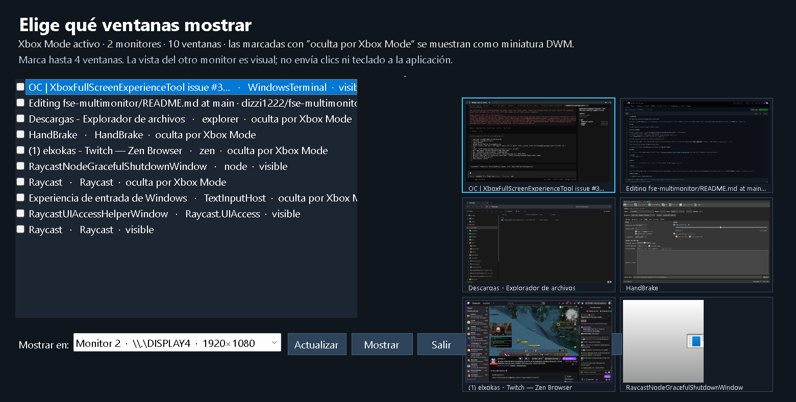
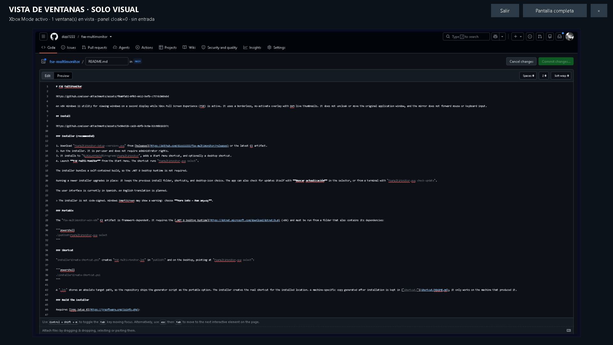

# FSE MultiMonitor

https://github.com/user-attachments/assets/f0a0fa82-0f03-4412-bef9-c757dcb08ebd

An x64 Windows 11 utility for viewing windows on a second display while Xbox Full Screen Experience (FSE) is active. It uses a borderless, no-activate overlay with DWM live thumbnails. It does not uncloak or move the original application window, and the mirror does not forward mouse or keyboard input.



## Install

https://github.com/user-attachments/assets/5e50e529-ca1b-49f9-bc6a-b2c66b191b7c

### Installer (recommended)

1. Download `FseMultiMonitor-Setup-<version>.exe` from [Releases](https://github.com/dizzi1222/fse-multimonitor/releases) or the latest CI artifact.
2. Run the installer. It is per-user and does not require administrator rights.
3. It installs to `%LOCALAPPDATA%\Programs\FseMultiMonitor`, adds a Start Menu shortcut, and optionally a desktop shortcut.
4. Launch **FSE Multi-Monitor** from the Start Menu. The shortcut runs `FseMultiMonitor.exe select`.

The installer bundles a self-contained build, so the .NET 9 Desktop Runtime is not required.

Running a newer installer upgrades in place: it keeps the previous install folder, shortcuts, and desktop-icon choice. The app can also check for updates itself with **Buscar actualización** in the selector, or from a terminal with `FseMultiMonitor.exe check-update`.

The user interface is currently in Spanish. An English translation is planned.

> The installer is not code-signed. Windows SmartScreen may show a warning: choose **More info → Run anyway**.

### Portable

The `fse-multimonitor-win-x64` CI artifact is framework-dependent. It requires the [.NET 9 Desktop Runtime](https://dotnet.microsoft.com/download/dotnet/9.0) (x64) and must be run from a folder that also contains its dependencies:

```powershell
.\publish\FseMultiMonitor.exe select
```

### Shortcut

`installer\Create-Shortcut.ps1` creates `FSE Multi-Monitor.lnk` in `publish\` and on the Desktop, pointing at `FseMultiMonitor.exe select`:

```powershell
.\installer\Create-Shortcut.ps1
```

A `.lnk` stores an absolute target path, so the repository ships the generator script as the portable option. The installer creates the real shortcut for the installed location. A machine-specific copy generated after installation is kept in [`shortcut/`](shortcut/README.md); it only works on the machine that produced it.

### Build the installer

Requires [Inno Setup 6](https://jrsoftware.org/isinfo.php):

```powershell
winget install JRSoftware.InnoSetup
.\installer\build-installer.ps1 -Version 1.1.0
```

Output: `installer\Output\FseMultiMonitor-Setup-1.1.0.exe`. The script publishes a self-contained x64 build to `artifacts\app` first, then compiles the installer.

## Run

The portable Windows x64 executable targets .NET 9 and requires the .NET 9 Windows Desktop Runtime.

```powershell
.\FseMultiMonitor.exe self-check
.\FseMultiMonitor.exe capture
.\FseMultiMonitor.exe watch 600
.\FseMultiMonitor.exe test-window
.\FseMultiMonitor.exe select
```

`select` opens a visible chooser while FSE is active and at least two displays are connected. The chooser lists the available windows and shows a live DWM thumbnail grid of six windows per page, with page controls next to **Vista previa**. Mark one to four windows, choose the destination monitor, then select **Mostrar**. Xbox Mode-cloaked windows can still appear in the chooser and be mirrored. The preview covers the selected monitor; **Pantalla completa** hides the title/status header and expands the thumbnails to fill the display, and **Vista ajustada** restores the fitted layout. **Salir** ends the app from inside the preview. Close the preview with **×** to return to the chooser. The selector and preview close when FSE ends.

The preview is visual only. It does not make the original window interactive, and protected or secure surfaces may not be available as DWM thumbnails. Window titles are shown transiently in the chooser and are not written to preview logs.



For scripts, list HWNDs and launch a preview directly:

```powershell
.\FseMultiMonitor.exe windows --include-titles
.\FseMultiMonitor.exe preview 0x00000000001c0d1c --monitor 2
```

The data directory defaults to `%LOCALAPPDATA%\FseMultiMonitor`. To save logs alongside this project:

```powershell
$env:FSE_MM_DATA = (Resolve-Path .).Path + '\data'
.\publish\FseMultiMonitor.exe capture
```

`capture` writes a JSONL record containing the FSE API state; active `QueryDisplayConfig` paths and modes; physical monitor/work-area coordinates and DPI; foreground window; visible and hidden top-level windows; DWM cloak results; desktop names; Windows build; and hashes/versions for selected loaded shell modules. Window titles are omitted by default. Use `--include-titles` only if the resulting local log may safely contain document names, browser tabs, and similar title text.

`watch [seconds]` writes an initial snapshot, state-change snapshots, and a final snapshot to JSONL. The duration defaults to 600 seconds and is capped at 1800 seconds. Stop it with Ctrl+C.

`test-window` opens a harmless text field and button for checking mouse focus and keyboard typing across displays. Its output includes its process ID.

The separate `testwindow\publish\FseTestWindow.exe --try-owner-uncloak` build performs one bounded, owner-process `DwmSetWindowAttribute(DWMWA_CLOAK=false)` attempt when its form is shown, then samples FSE and DWM state for at most 30 seconds. It logs to `FSE_MM_DATA` and closes at the bound. This is a diagnostic intervention, not a bypass.

## Reversible probe

While FSE is confirmed active and Windows reports two active display paths, select a current top-level window by the HWND shown in `capture` or by its controlled test-window PID. Move that one window to the secondary monitor for at most 30 seconds:

```powershell
.\FseMultiMonitor.exe probe 0x0000000000001234 30
```

The probe refuses hidden, minimized, or DWM-cloaked windows. It records the original rectangle and process start time to a transaction file before moving anything, keeps the window size and focus unchanged, samples FSE/window state, and restores the original rectangle automatically. Ctrl+C also triggers restoration. If the utility is interrupted during the probe, use the transaction ID it printed:

```powershell
.\FseMultiMonitor.exe restore <transaction-id>
```

Recovery checks both the HWND owner and process start time before moving it. The probe never persists display changes, installs a service, sets autostart, changes security configuration, or alters a shell binary.

## What the findings can establish

Two or more active display paths establish that Windows did not disable those display routes during the captured transition. The window records can show if a selected app was hidden, minimized, DWM-cloaked, moved, placed on another desktop, or simply ceased to be foreground. They cannot by themselves prove why the shell made that decision.

The Microsoft FSE API exposes both state-query calls and a global `SetGamingFullScreenExperience` call. This tool reads FSE state and reports whether the current session says that mode changes are allowed; it does not call the global setter because that is not a per-display exemption.

## Build

```powershell
dotnet build .\src\FseMultiMonitor.csproj -c Release -p:NuGetAudit=false
dotnet publish .\src\FseMultiMonitor.csproj -c Release -o .\publish -p:SelfContained=false -p:PublishSingleFile=true -p:NuGetAudit=false
```

## Current evidence

On the observed Windows 11 25H2 build 26200.9711, FSE remained active with two active 1920×1080 display paths. A normal test window reported `DWMWA_CLOAKED=2`, while the no-activate toolwindow overlay reported `0`. `DwmRegisterThumbnail` and `DwmUpdateThumbnailProperties` both succeeded, and the user confirmed the test form was visible inside the second-display panel. The production preview was then opened with the same result.

This verifies a live visual mirror on this machine and build. It does not prove that the original window has been uncloaked: the shell may continue to cloak it, and this app does not change that state. No input forwarding, anti-cheat compatibility, or protected-content capture has been verified. See `report.md` for details. Machine-specific JSONL logs are excluded from Git. `DWMWA_CLOAKED=2` means DWM reports that the shell cloaked the window ([Microsoft documentation](https://learn.microsoft.com/en-us/windows/win32/api/dwmapi/ne-dwmapi-dwmwindowattribute)).

No license is included; code reuse rights remain unspecified.
